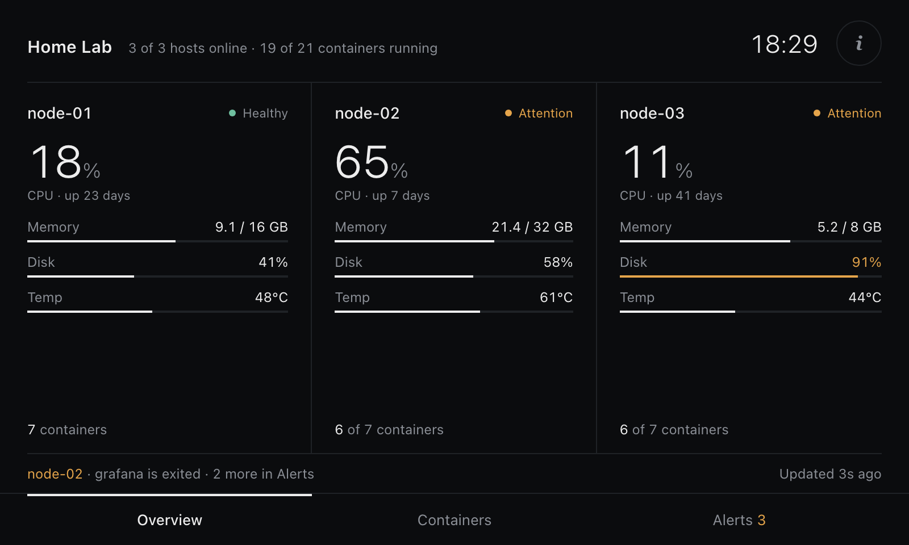
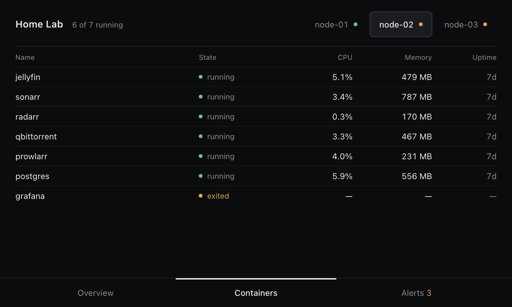
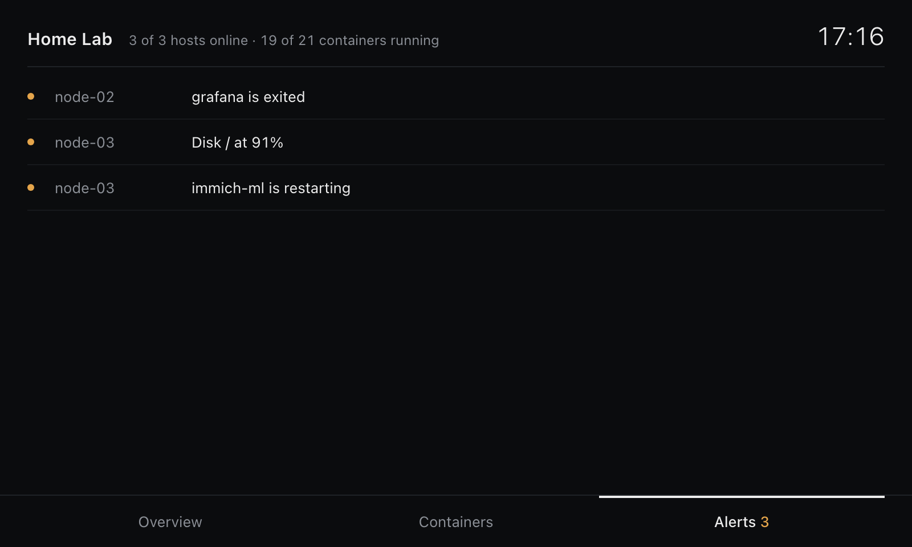

# Home lab dashboard

[](https://github.com/Hannimal/homelab-dashboard/actions/workflows/ci.yml)

A small status screen for a 5" Raspberry Pi display. Each Docker server runs a Glances agent, a lightweight aggregator on the Pi polls them, and a minimal dashboard runs full screen in Chromium.

```
 node-01 ─┐  Glances agent (Docker, :61208)
 node-02 ─┼──────────────►  Pi: server.py (:8080)  ──►  Chromium kiosk on the Waveshare
 node-03 ─┘                 polls every 5 s, works out alerts
```

Nothing to compile and no pip packages: the agent is the official `nicolargo/glances` image, and the Pi side is plain Python 3 plus one HTML file.

<p>
  
  
</p>
<p>
  
</p>

_Screenshots use the built-in demo data (`python3 server.py --demo`), at the screen's native 800×480._

> **Network use only.** There is no authentication anywhere in this setup. It is designed for a trusted home network. Read [Security notes](#security-notes) before exposing anything.

## Install

Both machines install from this repo with `install.sh`. It clones the repo into `~/homelab-dashboard-src`, runs the right installer, and **running it again updates everything**. Run it as your normal user, not with `sudo`. Docker, `git` access to GitHub and an internet connection are all it needs; `git` is installed for you if missing.

### 0. Get the installer

On each machine, download the installer and read it (it runs with `sudo`, so you should know what it does):

```bash
curl -fsSL https://raw.githubusercontent.com/Hannimal/homelab-dashboard/main/install.sh -o install.sh
less install.sh      # press q to quit. Prefer plain output? Use: cat install.sh
chmod +x install.sh
```

If `less` ever shows `[1]+ Stopped`, it was suspended by Ctrl+Z. Type `fg`, then `q`.

For reproducible installs, pin a release tag instead of following `main`: `REPO_REF=v1.1.0 ./install.sh ...`

### 1. Each of the 3 servers

Pass the Pi's IP so the firewall (`ufw`, when active) opens the agent's port only to the Pi:

```bash
./install.sh server 192.168.1.50      # ← your Pi's IP
```

It finishes with "Agent running on …". Repeat on the other servers. Docker and the Docker Compose plugin must already be installed.

### 2. The Raspberry Pi

No desktop is needed. The recommended base is **Raspberry Pi OS Lite (64-bit)**. The dashboard runs in `cage`, a tiny Wayland compositor that shows a single full-screen app, so there is no desktop, window manager or login screen.

1. Flash Raspberry Pi OS Lite (64-bit) with Raspberry Pi Imager. In Imager's settings, set the hostname, your user and password, Wi-Fi if needed, and turn on SSH.
2. Boot the Pi with the screen attached, SSH in, and run:

```bash
./install.sh pi --console
sudo nano /opt/homelab-dashboard/config.json     # put in your 3 server names and IPs
sudo reboot
```

The first run installs only `python3`, `curl`, `chromium` and `cage` (and `git` if missing), turns on console auto-login, and starts the service. The config you edit picks up changes within a few seconds, so there is no need to re-run anything. Before you reboot, check `curl -s localhost:8080/api/state` or run `/opt/homelab-dashboard/diagnose.sh`.

To try the screen before the servers are ready, run `./install.sh pi --demo`. It shows sample data. Run `./install.sh pi` later to switch to real data.

If the Pi already runs the desktop edition, leave out `--console` and the installer adds the dashboard to the desktop's autostart instead.

**Which Pi.** Chromium is the heaviest part of this setup. A Pi 3B+, 4 or 5 runs it comfortably. A Pi Zero 2 W or 3A+ (512 MB) works, but only just.

### Updating

Run the same command again on any machine. It fast-forwards the clone, reinstalls, and keeps your live settings in `/opt/homelab-dashboard/config.json`.

```bash
./install.sh pi --console
./install.sh server 192.168.1.50
```

To pin a version, set `REPO_REF` to a branch or tag (default `main`), for example `REPO_REF=v1.1.0 ./install.sh pi`. `INSTALL_DIR` changes where the clone lives.

**Using a private fork?** Set `REPO_URL` to your fork and give git access with a read-only fine-grained token (`REPO_TOKEN=github_pat_...`), an SSH deploy key (`REPO_URL=git@github.com:you/homelab-dashboard.git`), or `gh auth login`. A token is used for the clone only and is never saved in the clone's settings.

### Without GitHub access (copy from your computer)

If you'd rather push your local checkout straight to a machine over SSH, use `deploy.sh` (see [Working on the code](#working-on-the-code)).

## Using the screen

- **Overview** shows one column per server with CPU, memory, the fullest disk, container count and CPU temperature. Tap a server to see its containers.
- **Containers** lists every container on the selected server, with problems at the top. Tap the server names at the top to switch.
- **Alerts** lists everything that needs attention.
- The screen goes back to Overview after 90 seconds without a touch.

A server turns amber ("Attention") when any of these happen:

- CPU, memory, disk or temperature passes a threshold.
- A container is exited, restarting or dead.

It turns red ("Offline") when its agent stops answering. If the data stops updating, or the Pi service can't be reached, a red "stale" or "service unreachable" note appears next to the title on every screen.

## Settings (`/opt/homelab-dashboard/config.json` on the Pi)

| Key | What it does |
| --- | --- |
| `hosts` | Name and IP of each server. Add a 4th server here and the layout adapts. |
| `thresholds` | Warning levels for CPU %, memory %, disk % and temperature °C. |
| `hide_containers` | Containers never shown (the agent itself by default). |
| `expected_stopped` | Containers that are allowed to be stopped, such as one-shot backup jobs, so they don't raise alerts. Also accepted inside a single host entry (`"expected_stopped": ["backup"]`) to apply to that host only. |
| `alert_confirm_samples` | How many polls in a row a problem must last before it shows (default 2, about 10 s). Stops a value hovering at a threshold from flipping the screen back and forth. Set to 1 for instant alerts. |
| `disk_mounts` (per host) | Limit which mount points count as disks, e.g. `["/", "/host/data"]`. |
| `listen` / `port` | Where the Pi serves the page. Set `listen` to `"0.0.0.0"` to open the dashboard from your laptop too. |

Edit it on the Pi with `sudo nano /opt/homelab-dashboard/config.json`. Changes apply within a few seconds, with no restart needed. The only exceptions are `listen` and `port`, which need `sudo systemctl restart homelab-dashboard`.

A `pi/config.json` in the cloned repo (git-ignored) is only read when you run the installer, which copies it into `/opt`. Editing that copy does nothing until you re-run the installer; edit the one in `/opt` instead.

If you save invalid JSON, such as a missing quote or a trailing comma, the dashboard keeps running on the last good settings and shows the error in red at the bottom of the screen.

**Extra data disks.** The agent sees the server's root disk automatically. To include another disk such as `/mnt/data`, uncomment the example volume line in `/opt/homelab-agent/docker-compose.yml` on that server. Then run `docker compose up -d` in that folder.

## The Waveshare 5" display

Most Waveshare 5" screens work out of the box on current Raspberry Pi OS. If yours shows a wrong resolution or a black border:

- **HDMI models:** add `video=HDMI-A-1:800x480M@60` to the end of the single line in `/boot/firmware/cmdline.txt`, then reboot. Touch works over the USB cable.
- **DSI models:** follow the `dtoverlay` line on your model's Waveshare wiki page.

The dashboard scales itself to fit whatever resolution the screen reports, so it never gets cut off.

## Troubleshooting

| Symptom | Check |
| --- | --- |
| A server shows Offline | From the Pi: `curl http://SERVER_IP:61208/api/4/status`. On the server: `docker logs glances-agent`. |
| "Can't reach the dashboard service" | `systemctl status homelab-dashboard` and `journalctl -u homelab-dashboard -n 50` |
| Containers list is empty | The agent can't read Docker. Check that `/var/run/docker.sock` exists on that server. |
| No temperature shown | That machine exposes no CPU sensor to Glances. This is common in VMs, and harmless. |
| Kiosk didn't open after reboot | Over SSH, run `/opt/homelab-dashboard/diagnose.sh`. It checks each piece and prints the fix. The kiosk's own log is `~/.cache/homelab-kiosk.log`. |
| Pi has a desktop installed but you want the console kiosk | `./install.sh pi --console` |
| Screen goes black after a while | `sudo raspi-config` → Display Options → Screen Blanking → No |

## Security notes

This project is meant for a **trusted home network**. What that means in practice:

| Piece | Exposure | What protects it |
| --- | --- | --- |
| Glances API on each server (`:61208`) | Read-only JSON, **no password** | The installer adds a `ufw` rule allowing only the Pi's IP. It prints a warning when it can't (no Pi IP given, or `ufw` missing or inactive). Never expose this port to the internet. |
| Agent container | Mounts the Docker socket, so a compromised agent can control Docker on that host. `:ro` does not prevent this, it only stops the socket file being replaced | Image pinned to a specific version, `no-new-privileges`, firewall rule above. Keep the pin updated (Dependabot opens a PR monthly). |
| Dashboard on the Pi (`:8080`) | Shows server names, IPs and container names, **no password** | Listens on `127.0.0.1` by default. Only set `listen` to `0.0.0.0` on a network you trust. Responses carry a strict Content-Security-Policy, `nosniff` and no-referrer headers, and all data is HTML-escaped in the page. |
| Aggregator service | Polls the agents over plain HTTP | Runs as a throwaway user (`DynamicUser`) with no capabilities, a read-only filesystem, a private `/tmp` and only IP and local sockets allowed. |
| `install.sh` | Runs repository code with `sudo` | Read it before running, pin `REPO_REF` to a release tag, or review changes after `git pull`. Tokens are never written into the clone's remote URL. |

What is **not** in this repo: no credentials, tokens or keys of any kind. Your real `pi/config.json` (which holds your server IPs) is git-ignored. Only `config.example.json` with placeholder addresses is tracked.

Hardening ideas if you want more: put the servers and the Pi on their own VLAN, or tunnel the agent port over WireGuard instead of opening it to the LAN.

To report a vulnerability, see [SECURITY.md](SECURITY.md).

## Working on the code

This folder is a git repository. Your real `pi/config.json`, which holds your IPs, is git-ignored. Only `config.example.json` is tracked.

To push your local checkout to a machine and run its installer without going through GitHub, use `deploy.sh`. It replaces the remote folder each time, so the nested-folder problem with `scp` can't happen.

```bash
./deploy.sh pi you@192.168.1.50 --console
./deploy.sh server you@192.168.1.11 192.168.1.50   # last argument: the Pi's IP, for the firewall rule
```

Re-deploying the Pi keeps your live settings in `/opt/homelab-dashboard/config.json`.

To test the dashboard on your computer without a Pi:

```bash
cd pi && cp config.example.json config.json && python3 server.py --demo
# open http://127.0.0.1:8080
```

Tests (standard library only) and the checks CI runs:

```bash
python3 -m unittest discover -s tests -v
shellcheck -S warning deploy.sh install.sh pi/*.sh servers/*.sh
```

### Layout

| Path | What it is |
| --- | --- |
| `servers/` | Glances agent: `docker-compose.yml`, `glances.conf`, `install-agent.sh` |
| `pi/server.py` | Aggregator. Polls the agents, works out alerts, serves `/api/state` and the page. Standard library only. |
| `pi/web/index.html` | The dashboard, designed at 800×480 |
| `pi/kiosk.sh`, `pi/start-kiosk.sh` | Start Chromium in cage, with logging and retries |
| `pi/install-pi.sh`, `pi/diagnose.sh` | Pi installer and health check |
| `install.sh` | Install or update a machine from GitHub (clones the repo, runs the installer) |
| `deploy.sh` | Push your local checkout to a machine over SSH and install |
| `docs/` | Screenshots used in this README |
| `tests/` | Unit tests for the aggregator |
| `.github/workflows/ci.yml` | Runs the tests, ShellCheck and a compose-file check |

## Uninstall

- **Server:** `cd /opt/homelab-agent && sudo docker compose down && sudo rm -rf /opt/homelab-agent`
- **Pi:** `sudo systemctl disable --now homelab-dashboard && sudo rm -rf /opt/homelab-dashboard /etc/systemd/system/homelab-dashboard.service`, then remove the "homelab-dashboard kiosk" block from `~/.profile` (Lite) or the `kiosk.sh` line from `~/.config/labwc/autostart` (desktop).

## License

[MIT](LICENSE)
